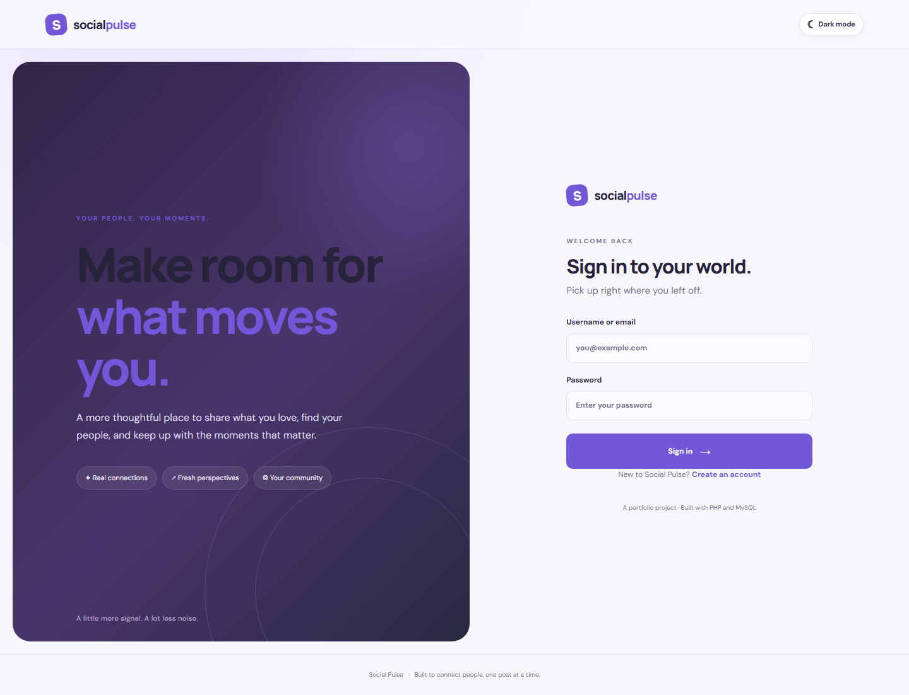
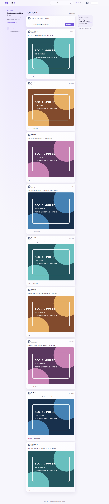
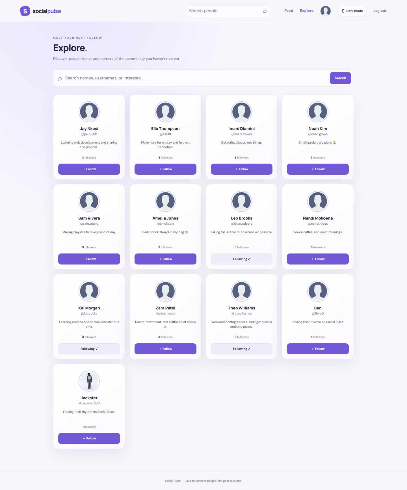
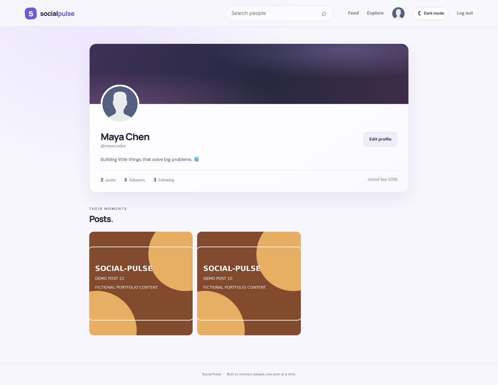
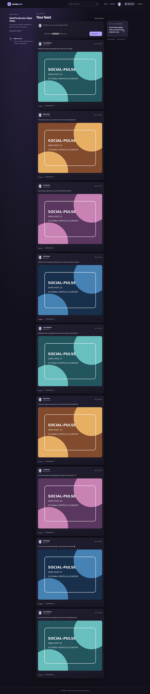
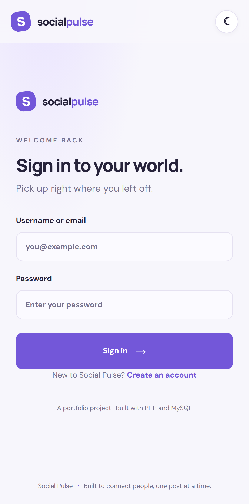
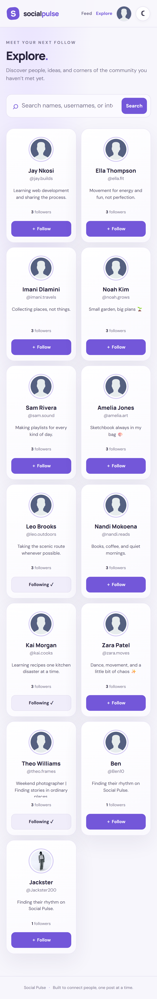

# Social-Pulse — Social Media Platform

Social-Pulse is a PHP and MySQL social media web application built as a portfolio project. Users can create accounts, share posts with images, explore content, interact with other users, and manage their profiles through a responsive interface.

## Features

- **User authentication:** Register, log in, and log out.
- **Home feed:** View posts and create new posts with captions and images.
- **Likes and comments:** Interact with posts and save interactions in the database.
- **Explore:** Search and discover users and content.
- **User profiles:** View profiles and manage profile information.
- **Follow system:** Follow and unfollow other users.
- **Image uploads:** Upload images with file validation.
- **Light and dark themes:** Switch between different display themes.
- **Responsive design:** Supports desktop and mobile-sized screens.
- **Session protection:** Restricts access to pages that require authentication.

## Screenshots

### Desktop

Login page

Home feed

Explore page

User profile

Dark mode


### Mobile


Mobile home feed

Mobile Explore

Mobile dark mode


## Technologies Used

- **PHP** — Server-side application logic.
- **MySQL / MariaDB** — Database storage.
- **HTML5** — Page structure.
- **CSS3** — Styling and responsive layouts.
- **JavaScript** — Client-side interactions.
- **Apache** — Local web server through XAMPP.
- **Playwright** — Browser automation and screenshot capture.
- **Git and GitHub** — Version control and project hosting.

## Requirements

Before running Social-Pulse locally, install:

- XAMPP with Apache, PHP, and MySQL/MariaDB.
- A modern web browser.
- Git, if you want to clone the repository.
- Node.js and npm, if you want to run the Playwright screenshot script.

## Installation and Setup

### 1. Clone or download the project

To clone the repository, open a terminal and run:

```bash
git clone https://github.com/LithaMadlingozi03/Social-Pulse.git
```

For a standard XAMPP installation on Windows, place the project folder inside:

```text
C:\xampp\htdocs\SocialPulse-Portfolio\
```

If you cloned the repository into a folder named `Social-Pulse`, either use that folder name in the URL or rename the folder to `SocialPulse-Portfolio`.

### 2. Start XAMPP

1. Open the XAMPP Control Panel.
2. Start **Apache**.
3. Start **MySQL**.

### 3. Create and import the database

1. Open phpMyAdmin at `http://localhost/phpmyadmin/`.
2. Create the database with the name expected by the application's database configuration.
3. Import `database/schema.sql` first.
4. If you want sample records, import `database/demo_data.sql` after the schema.

The schema creates the database structure. The demo data file supplies sample records, if included and compatible with that schema.

### 4. Configure the database connection

Check `connect.php` and the project's local configuration files to see which database name, username, password, and connection settings the application expects.

Configure your local environment accordingly. Keep real passwords and other private credentials out of GitHub. Use `config.local.example.php` as a reference if it documents the required settings.

### 5. Run the application

Open the following URL in your browser:

```text
http://localhost/SocialPulse-Portfolio/
```

The application's login page is available at:

```text
http://localhost/SocialPulse-Portfolio/index.php
```

Register a new account or use a demo account if the imported demo data includes valid login credentials.

## Project Structure

```text
SocialPulse-Portfolio/
├── app.php
├── connect.php
├── index.php
├── login.php
├── logout.php
├── register.php
├── registration.php
├── feed.php
├── create_post.php
├── submit-post.php
├── explore.php
├── profile.php
├── edit-profile.php
├── follow.php
├── like.php
├── post.php
├── image-detail.php
├── database/
│   ├── schema.sql
│   └── demo_data.sql
├── screenshots/
├── scripts/
│   └── capture-screenshots.js
├── config.local.example.php
├── package.json
├── package-lock.json
└── README.md
```

*This is a guide to the main files and folders; the actual repository may contain additional files.*

## Testing

The application has been tested for the following functionality:

- Account registration and login.
- Logout and protection of authenticated pages.
- Creating posts and uploading images.
- Rejecting invalid image uploads.
- Persistent likes and comments.
- Multiple user accounts.
- Searching through Explore.
- Following and unfollowing users.
- Viewing and editing profiles.
- Light and dark theme switching.
- Desktop and mobile layouts.

## Browser Screenshot Automation

Playwright is used to automate browser navigation and capture screenshots of the application

## Security Notes

- Keep database credentials and private configuration files out of version control.
- Use password hashing and verification for account passwords.
- Validate uploaded files on the server.
- Use parameterized SQL queries to reduce SQL injection risks.
- Protect authenticated routes and verify permissions before allowing changes.
- Use HTTPS and suitable production configuration before deploying publicly.

## Future Improvements

Possible future improvements include:

- Password reset and email verification.
- Notifications for likes, comments, and new followers.
- Pagination or infinite scrolling for the feed.
- Improved accessibility and automated testing.
- Deployment to a production hosting environment.

## Author

**Litha Madlingozi**

GitHub: [LithaMadlingozi03](https://github.com/LithaMadlingozi03)

Project repository: [Social-Pulse](https://github.com/LithaMadlingozi03/Social-Pulse)

---

*Social-Pulse is a portfolio project demonstrating web development, database integration, user authentication, and interactive application features.*
